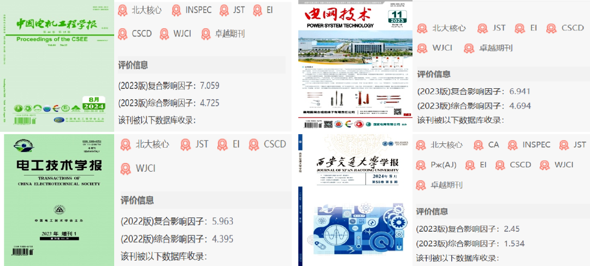
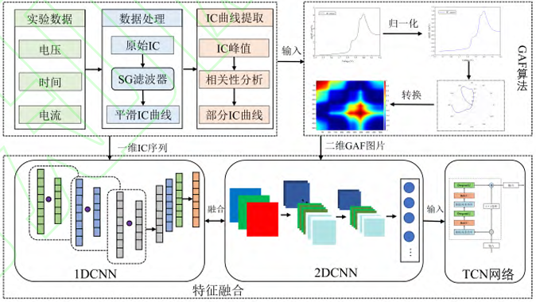
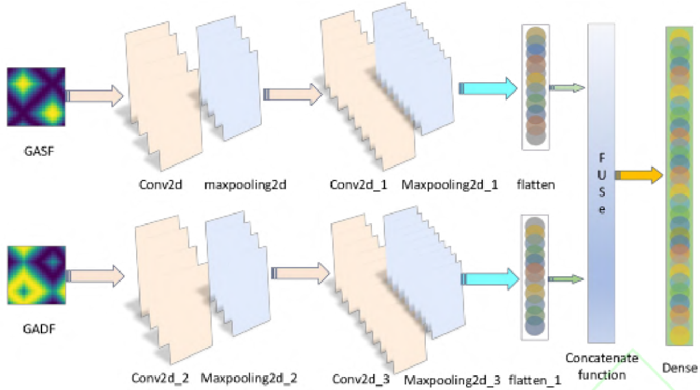
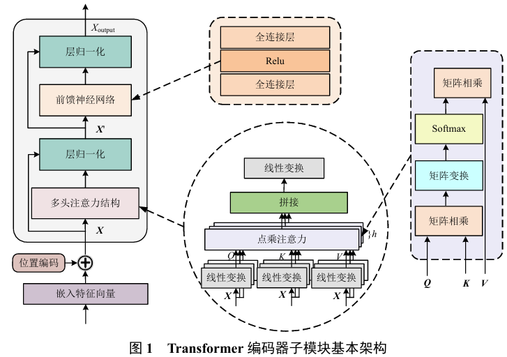
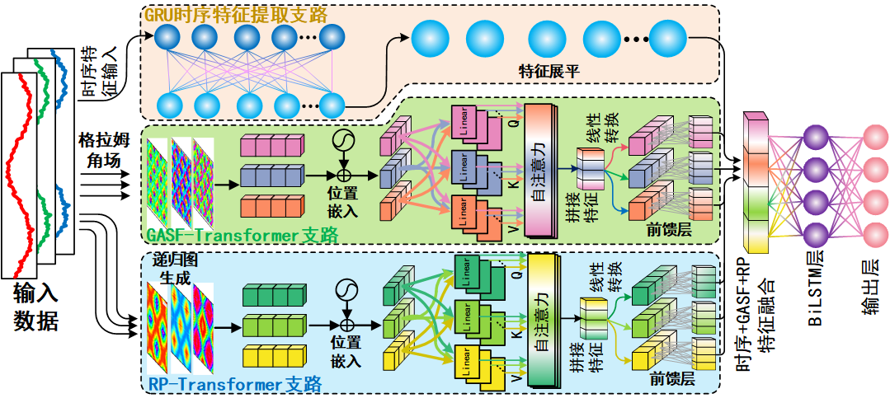
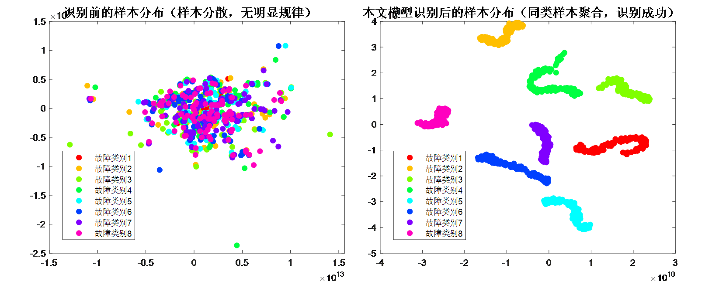
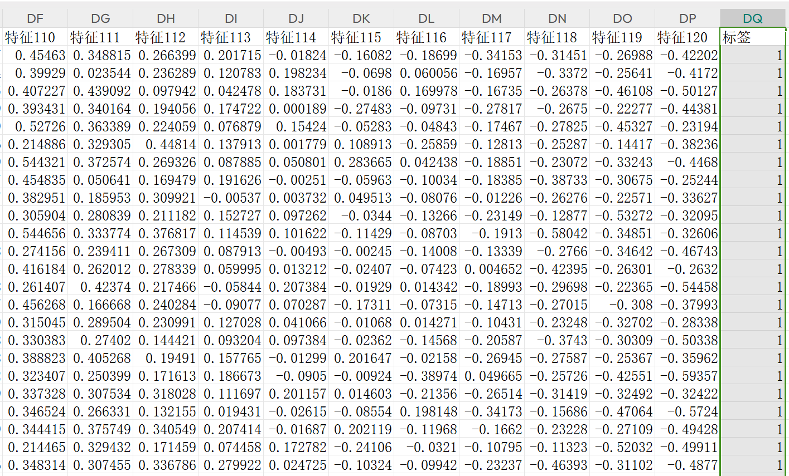
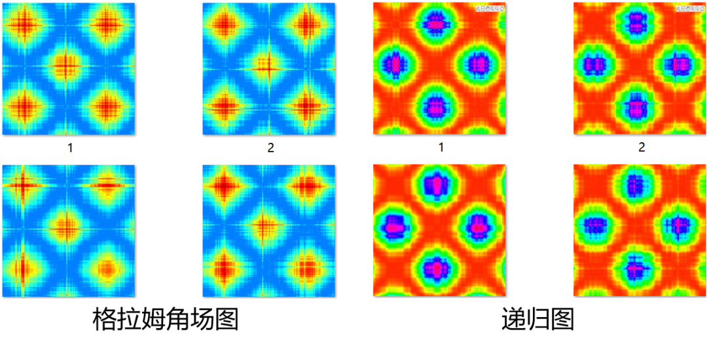
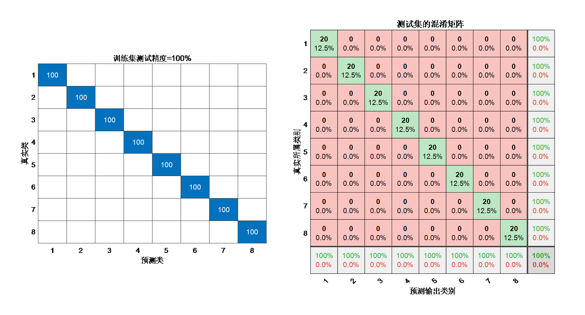
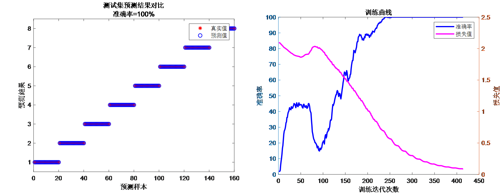

# 1D-2D-Transformer+GASF+RP+GRU - Innovative and fully loaded! Accuracy up to 100%! A classification program that even beginners can use!

Applicable Platform: Matlab2023b and above.
References:
1. Chinese EI journal "Journal of Xi'an Jiaotong University" document: "Health state estimation of lithium-ion batteries using a hybrid model of Gram angle field-convolutional neural network-time series convolutional network"; ① Time series + image fusion model; ② One-dimensional time series to Gram angle field model.
2. Top Chinese EI journal "Electrical Technology Journal" online first literature: "High resistance contact fault diagnosis of permanent magnet synchronous motor based on multi-channel signal two-dimensional recursive fusion and ECAConvNeXt"; ③ One-dimensional time series transformation recursive graph RP method.
3. Top Chinese EI journal "Power Grid Technology" literature: "Health diagnostic of switch tubes in grid-connected inverters based on parallel CNN and Gram angle field"; ④ Differential image feature complementary method.
4. Top Chinese EI journal "China Electric Machinery Engineering" literature: "Multi-stage transient stability assessment method for power systems based on self-attention transformer encoder"; ⑤ Transformer encoder method.
Data preprocessing references: In the first and second references, one-dimensional waveforms are converted into two-dimensional Gram angle field GASF and recursive graph RP two-dimensional images;
Image feature extraction references: In the fourth reference, a Transformer model is built to extract spatial features from recursive graphs and Gram angle fields.
Time series + image; 2 different image mixing references: Multimodal heterogeneous image mixing feature extraction, branch 1 uses time series waveform input, GRU neural network extracts time series temporal features, branch 2 uses Transformer encoder to extract GASF image features, branch 3 uses Transformer encoder to extract RP image features, achieving integration of time series, image space, heterogeneous image features forming a fault recognition model program of multimodal heterogeneous image mixing feature extraction with time series, image space, and Gram angle field-RP-Transformer-GRU.
The innovation is substantial, capable of supporting high-level academic papers and simple tasks such as master's thesis and course design.

Document 1 Analysis:
A feature fusion network is proposed, converting sequences into Gram angle field two-dimensional images. The image features are extracted from the two-dimensional images using a CNN, while the temporal features are extracted from one-dimensional waveform sequences using a one-dimensional convolutional neural network. The temporal features are fused with the image features to accurately estimate the health status of lithium-ion batteries.

Document 2 Analysis:
An approach for transforming one-dimensional sequences into two-dimensional recursive graphs is introduced, mapping one-dimensional current signals into two-dimensional images to enhance the richness of fault characteristic information and eliminate the impact of manual feature extraction. This enhances the display of fault characteristics and employs a convolutional neural network with attention mechanisms and residual connections to achieve effective fault classification.

Document 3 Analysis:
In this paper, firstly, time-series sequences of one-dimensional fault voltage and current signals are collected; secondly, they are transformed by Gram summing field (GASF) and difference field (GADF), respectively, to convert the two one-dimensional time-series signals into two types of images. After the integration of the two types of features, they are fed into a CNN for parallel learning and training to realize inverter fault diagnosis.

Document 4 Analysis:
A power system transient stability assessment method based on Transformer encoder is constructed. The Transformer utilizes an attention mechanism to achieve global receptive fields, enabling the model to quickly capture the global state dependencies between the power system before and after moments, which has good interpretability and high fault recognition accuracy.

This article models:
A multimodal heterogeneous feature extraction fault identification model based on 1D-2D-GASF-RP-Transformer-GRU - A novel fault identification model combining multiple modalities.

The main steps are: simply require raw fault waveform data, then according to the waveform data, convert the one-dimensional sequence into two-dimensional Gram angle field and recursive images, even beginners can start!
Firstly, Transformer is applied to the field of fault identification for extracting global features of images, which is significantly innovative.
Secondly, branch 1 extracts one-dimensional time series waveform features through a GRU network, effectively capturing the dynamic changes in the time series data and improving feature extraction efficiency.
Branch 2 converts one-dimensional time series waveform into two-dimensional GASF images, achieving global trend capture and providing abundant angle information.
Branch 3 transforms one-dimensional time series waveform into two-dimensional recursive graph (RP) images, revealing nonlinear dynamical characteristics in the time series, enhancing the accuracy of fault identification.
Before the output layer, a BiLSTM is introduced to capture bidirectional sequential dependencies, further improving the fault identification capability of the model.
Nine innovative points:
1. Multimodal Fusion: The integration of one-dimensional time series signals with two types of mixed two-dimensional images allows for the comprehensive utilization of different modalities, thereby more comprehensively describing the characteristics of the data. This helps to extract richer and more distinctive features, thereby improving classification and recognition accuracy.
2. Time Series Information Acquisition: GRU (Gated Recurrent Unit) is a type of recurrent neural network suitable for time series data, capable of capturing dynamic changes and trends in one-dimensional time series signals. By parallelizing GRU with a new Transformer, the algorithm can consider both temporal and spatial features simultaneously, further enhancing its performance.
3. Spatial Feature Learning: The dual branch Transformer performs exceptionally well in global feature extraction, effectively learning spatial features and local patterns of images. Applying Transformer to image data processing can help extract texture, shape, and edge features of images, aiding in more accurate classification and fault identification.
4. Fusion Advantage: By integrating information from different modalities, the algorithm can compensate for the limitations of one-dimensional time series signals and two-dimensional images. For example, images may be more sensitive to certain fault modes, while time series signals are more sensitive to other modes. Combining them together can enhance the algorithm's robustness and generalization capabilities.
5. Multi-Head Self-Attention Mechanism: The Transformer integrates the multi-head attention mechanism effectively to grasp the contribution of feature extraction, focusing on enhancing key features to improve the accuracy of fault identification.
6. Enhancing Generalization Ability: Multimodal fusion helps algorithms better understand the essential characteristics of data, thereby reducing the risk of overfitting and enhancing the algorithm's generalization ability on new data.
7. Fusion of Dissimilar Image Features: GASF captures global trends while RP emphasizes local non-linear features. Combining these two enriches the feature space, providing complementary information for both global and local, linear and nonlinear features, enhancing the model's discriminative power.
8. Bidirectional Feature Secondary Extraction: Introducing a bidirectional long short-term memory network (BiLSTM) before the output layer can effectively capture bidirectional temporal dependencies, further enhancing the model's capability to capture fault patterns, achieving more precise fault classification and calculating evaluation metrics such as precision, recall, accuracy, and F1 score.
9. Interpretability: To enhance model interpretability, t-SNE interpretability algorithm is applied to visualize the feature maps of each branch module; comparing the distribution of samples after original samples and 1D-2D-BiTransformer-GRU multimodal fusion feature extraction.
Applicable Fields: Suitable for various data classification scenarios, such as rolling bearing faults, transformer oil gas faults, fault detection and classification in power system transmission lines, insulators, substations, and disturbances in electric energy quality, etc.
Data format: Each row represents an individual sample, with the last column being the fault type label of the sample.
Program Results: (Automatically converted from the one-dimensional sequence into recursive graph RP images)
Program Results:
Follow the editor for irregular but innovative learning materials, articles, and code updates, fueling your research endeavors!

## Images

<!-- PAYMENT_BLOCK -->

## Get this dataset

- Payment link (Stripe): [Buy now](https://buy.stripe.com/3cs8yP7sY87d0vu9AB)
- Payment QR code: 

<!-- /PAYMENT_BLOCK -->
